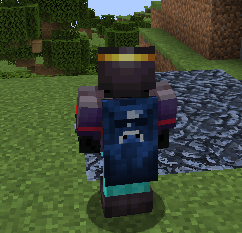

# Custom Cape — RusherHack 1.21.11

<p align="center">
  
</p>

Wear any cape you want. **Custom Cape** is a RusherHack core plugin that adds a **Custom Cape** setting to the built-in **Capes** module (`Modules → Client → Capes`). Drop a PNG in a folder, pick it in the module settings, and it shows on your back right away. It shows on your elytra too.

## Features

- **Your own capes** — any `.png` in `rusherhack/capes/` shows up as an option.
- **Elytra sync** — the same texture is used on your cape *and* your elytra.
- **Real-time selection** — switch capes from the Capes module settings, no restart needed.
- **`*cape reload`** — rescans the folder after you add or remove PNGs.
- **Remembers your pick** — your selected cape is restored on the next launch.
- **Zero setup** — the `rusherhack/capes/` folder is created on first launch.
- **Multiplayer sharing** — automatically share your selected cape with other plugin users, with no additional configuration.

## Installation

1. Add the JVM flag `-Drusherhack.enablePlugins=true` to your Minecraft JVM arguments.
   > ⚠️ Make sure there is no trailing space or tab after `true`, or RusherHack silently loads 0 plugins.
2. For multiplayer sharing, build this fork and install `custom-capes-1.1.0.jar` from `build/libs/`. The original version is available from [Esat32 Releases](https://github.com/Esat32/Custom-Cape-1.21.11/releases).
3. Put it in `.minecraft/rusherhack/plugins/`.
4. Launch the game. This is a **core plugin** (it uses mixins), so it must be in the folder *before* launching and can't be loaded with `*reload`.

Check that it loaded with `*plugins`.

## Usage

1. Put your cape PNGs into `.minecraft/rusherhack/capes/`.
2. In game, run `*cape reload`.
3. Open the ClickGUI → **Client → Capes**, make sure the module is **enabled**, and pick your file in **Custom Cape**.
4. Choose `None` to go back to your normal cape.

Your Minecraft *Skin Customization → Cape* option must be on for the cape to render.

### Cape format

Use a standard Minecraft cape texture: **64×32** (or any 2:1 size such as 128×64, 256×128 for HD). The elytra uses the elytra area of the same texture, like vanilla and OptiFine capes.

## Commands

| Command | Description |
|---|---|
| `*cape reload` | Rescan `rusherhack/capes/` and update the list in the Custom Cape setting |

## Building

Requires JDK 21.

```sh
./gradlew build
```

The jar is written to `build/libs/`.

Built on the [RusherHack example core plugin](https://github.com/RusherDevelopment/example-core-plugin).
